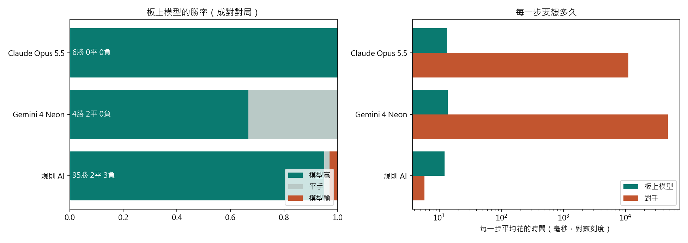

# 貪食蛇 AI 對戰：板上小模型 vs 雲端大模型

在 **Arduino UNO Q** 上跑一個自己訓練的強化學習模型（193 萬參數），讓它在 8×13 LED 矩陣上下雙人貪食蛇，
對手是板上的規則 AI，以及透過筆電呼叫的雲端大模型 **Gemini 4 Neon** 和 **Claude Opus 5.5**。

想回答的問題：**專門訓練的板上小模型，在需要即時決策的對戰裡，能不能贏過通用的雲端大模型？**
比兩件事：勝率（成對對局），以及每一步要想多久。

- Demo 影片：https://youtu.be/VuA4XbY6BYM （2 分 54 秒）；旁白逐字稿 [`replays/demo.srt`](replays/demo.srt)，影片腳本 [`film/story.json`](film/story.json)
  - 實拍只有一段：Claude Opus 第 5 局的**即時對局**（先原速 10 秒，再快轉 ×16）；Gemini 那局是照紀錄重新模擬的重播，畫面上都有標明
- 投影片：[`slides/deck.pdf`](slides/deck.pdf)
- 重播網頁：用瀏覽器直接打開 [`pc/replay_web/index.html`](pc/replay_web/index.html)，可以一步一步看每一局

## 結果

<!-- results:start -->
| 對手 | 局數 | 模型贏 | 平 | 模型輸 | 模型每步 | 對手每步 | 平均步數 |
|---|---:|---:|---:|---:|---:|---:|---:|
| 規則 AI | 100 | 95 | 2 | 3 | 12.3 ms | 5.8 ms | 44 |
| Gemini 4 Neon | 6 | 4 | 2 | 0 | 13.7 ms | 48.3 秒 | 49 |
| Claude Opus 5.5 | 6 | 6 | 0 | 0 | 13.4 ms | 11.1 秒 | 42 |

- **速度**：板上模型每步約 12～14 ms，Gemini 平均 48 秒（約 3,500 倍）、Opus 11 秒（約 830 倍）；板上推論不用網路、不花額度。
- **勝負**：對大模型 12 局沒輸（Gemini 4 勝 2 平、Opus 6 勝）。局數少，只能說在這個遊戲上「專門訓練的小模型不輸通用大模型」，不能說它比較聰明。
- **可用性**：一個晚上碰到三次額度上限（Opus 兩次、Gemini 一次），Opus 最後把 agy 的整週額度用完，只好換管道。要即時控制的裝置，不能每一步都等雲端。
- **分工**：雲端負責重的訓練（A100 跑 7.9 億步），板子負責即時推論；這就是這個專題想示範的邊緣 AI。
- **下一步**：讓模型避開一樣長的頭撞頭、把權重量化縮小、增加大模型的局數。


<!-- results:end -->

## 系統架構

```
① Colab A100：PPO 自我對弈 + 對手池 ──匯出 weights.npz──▶ ② Arduino UNO Q（比賽時不用網路）
                                                         ├─ Linux 端 main.py：遊戲規則、模型推論（numpy，約 12 ms/步）、規則 AI、WebUI（port 7000）
                                                         └─ MCU 端 sketch.ino：用 Bridge RPC 收畫面，畫 8×13 LED（模型那條亮、對手那條暗）
③ 筆電 pc/llm_bridge.py ◀──盤面（socket.io，經 adb 轉發）──▶ 板子
      └─ agy CLI ──▶ ④ Gemini 4 Neon / Claude Opus 5.5（不需要 API 金鑰，用自己登入的訂閱）
         （Opus 第 2～6 局：agy 的 Opus 額度用完，改用 Claude Code CLI 呼叫同一個模型，見「限制」）
```

## 遊戲規則

- 8 × 13 格（跟 UNO Q 的 LED 矩陣一樣大），兩條蛇**同時**移動，場上 1 個食物，起始長度 3。
- 撞牆、撞到任何蛇的身體就死；對方這一步沒吃東西的話，牠的尾巴會讓開。
- 頭撞頭：比長度（吃完之後的長度），長的活、短的死，一樣長兩條都死。
- 40 步沒吃到食物就餓死；第 300 步時比長度，一樣長算平手。
- 一條死另一條就贏，兩條同時死算平手。

## 訓練（`snake_duel.py`）

- GPU 批次環境（整個遊戲用張量寫，所有對局一起走一步），Colab A100 約 11 萬步/秒，共 **7.93 億步**。
- PPO；70% 的對局跟「現在的自己」打，30% 從 50 個舊版本的對手池裡挑，越打不贏的越常挑（PFSP）。
- 網路：3 個殘差塊、64 通道卷積；輸入 12 個通道（自己和對手各 3 個：頭、身體、身體剩幾步；再加食物、棋盤範圍（全 1）、長度差、自己的飢餓值、對手的飢餓值、剩幾步，共 6＋6）；輸出 4 個方向的機率和局面評分。
- 獎勵：贏 +1、輸 −1、平手 0；吃食物的零和小獎勵（+0.05 / −0.05）在前 2,000 萬步線性降到 0。
- 評估曲線在 [`training/a100_eval.csv`](training/a100_eval.csv)：對規則 AI 的勝率從 4.4 億步開始評估，之後一直在 90～94%，已經到平台期。

## 部署（`board-app/`）

- `python/snake_core.py`：numpy 版的遊戲規則、模型推論、規則 AI。板子上每一步推論約 12～14 ms（對規則 AI 的 100 局平均 12.3 ms，對大模型的局 13.4～13.7 ms）。
- `python/main.py`：主持對局；用 Bridge 把畫面送給 MCU；用 WebUI（socket.io）把盤面送給網頁和筆電。
- `sketch/sketch.ino`：MCU 只負責畫 LED（8 階亮度）。
- 權重 `weights.npz`（7.7 MB，float32）由 `export_weights.py` 從 `models/a100_it1300.pt` 轉出。

## 評估方法

- **成對對局**：同一個開局打兩次，第二次兩邊交換，抵消開局的運氣。開局種子固定（從 20261120 起），每個對手都打同一組開局。
- 板上模型每一步選機率最高的動作（固定策略），跟對手同時出手，看不到對手這一步要走哪裡。
- **規則 AI**（對照組，也在板子上跑，`snake_core.RuleBot`）：不走會撞牆、撞身體的方向；用 BFS 算到食物的距離，越餓越重視吃；用填色檢查走過去的空間至少比自己長度大；頭撞頭只有自己比較長時才會去撞。
- 大模型拿到的是文字盤面、完整規則、雙方的頭位置和飢餓值、合法方向，只能回一個方向（prompt 在 `pc/llm_bridge.py`）。兩個大模型都用 **high** 推理檔位（Gemini 4 Neon High、Claude Opus 5.5 effort high）。
- 大模型的時間是**每步回應時間**：筆電呼叫 CLI 到拿到答案，包含網路和 CLI 啟動；板上模型的時間只算 numpy 推論。
- 大模型打到一半額度用完：盤面停在那一步，等額度重置再接著打（等的時間不算進回應時間）。開局第一步就沒額度、或有任何一步沒回答的局一律**作廢**，同一個開局重打，不會算成模型贏。
- 每一局都存了開局種子、每一步雙方的動作、雙方花的時間、模型的局面評分、大模型的原始回答（`logs/games.jsonl`）。
- `pc/export_scene.py` 會用種子＋動作把每一局重新模擬一次，確認步數、長度、勝負都跟紀錄一樣。

## 正確性檢查

| 檢查 | 指令 | 結果 |
|---|---|---|
| 規則測試（撞牆、頭撞頭、尾巴讓開、同時吃食物、成對對局公平…） | `python test_rules.py` | 32 項全部通過 |
| 板上 numpy 版 vs 訓練用 PyTorch 版（觀察、規則、網路輸出） | `python test_board_core.py` | 輸出最大差 < 1e-3，64 個盤面最佳動作全部一致 |
| 對局紀錄重新模擬 | `python pc/export_scene.py` | 每一局都對得上 |

## 怎麼重現

```bash
pip install torch numpy python-socketio[client] websocket-client matplotlib pillow playwright
python test_rules.py                    # 規則測試
python snake_duel.py bench              # 環境速度測試
python snake_duel.py train 60           # 訓練 60 分鐘（Colab A100 用 snake_duel_colab.ipynb）
python export_weights.py models/a100_it1300.pt
python test_board_core.py               # 板上版跟 PyTorch 版一致

# 部署到板子（App Lab 的 App），再把網頁轉到筆電
adb push board-app /home/arduino/ArduinoApps/snake-duel
adb shell arduino-app-cli app start user:snake-duel
adb forward tcp:7000 tcp:7000           # 之後開 http://localhost:7000

# 跟大模型對打（筆電要裝好 agy 並登入）
python pc/llm_bridge.py --run gemini:6 --run opus:6 --resume
# agy 的 Opus 額度用完時：Opus 改走 Claude Code CLI（同一個模型、同一個 prompt，要先 claude auth login）
python pc/llm_bridge.py --run opus:6 --resume --opus-via claude

# 統計、重播、投影片、影片
python pc/summary.py
python pc/export_scene.py
python pc/build_deck.py
python pc/render_video.py --story film/story.json --out replays/demo.mp4
```

### Demo 影片是怎麼做的

- **實拍只有一段**：Claude Opus 第 5 局（`logs/games.jsonl` 裡 opus 的 index 4，2026-11-20 10:48～10:59）是**現場即時對局**。手機拍的是筆電上板子的網頁（http://localhost:7000）和板子上的 LED，從第 14 步拍到結束。影片先原速放第 16 步（Opus 回應 11.7 秒、板上模型 13 ms），再從第 17 步快轉 ×16 到結束；右邊的資訊卡蓋住的是網頁的控制面板。
- **Gemini 那段是重播**：照紀錄用種子＋動作重新模擬（`pc/replay_web`），畫面上標明「不是實拍」。
- 剪輯：`pc/render_video.py` 照 `film/story.json` 把投影片、手機影片、重播畫面接起來；旁白用 Windows 內建的 Yating 語音離線產生（`pc/tts_yating.ps1`），逐字稿在 `replays/demo.srt`。
- `pc/film_studio.py`（讓板子照紀錄在 LED 上重播大模型對局）和 `pc/film_session.py`（用筆電鏡頭錄 LED）是準備拍攝時寫的工具，最後的影片**沒有用到**。

沒有接板子也能測：`PYTHONPATH=pc/fake_arduino PORT=7100 python board-app/python/main.py` 會在筆電上跑一個假板子。

## 檔案

| 路徑 | 內容 |
|---|---|
| `snake_duel.py` | GPU 批次環境、PPO 自我對弈、對手池、評估 |
| `test_rules.py`、`test_board_core.py` | 規則測試、板上版一致性測試 |
| `board-app/` | UNO Q 的 App（Python + Arduino sketch + 網頁） |
| `pc/llm_bridge.py` | 筆電端：把盤面送給大模型、回傳一步、記錄每一局；板子重開會自動救援、`--resume` 接續 |
| `pc/film_studio.py` | LED 拍攝台（http://localhost:8800）：讓板子照紀錄重播大模型對局；準備拍攝時寫的，最後影片沒用到 |
| `pc/film_session.py` | 用筆電鏡頭錄 LED 並記下每一步的時間；最後影片沒用到 |
| `pc/tts_yating.ps1`、`film/story.json` | 影片旁白（Windows 內建語音，離線）、影片腳本 |
| `pc/summary.py`、`pc/export_scene.py`、`pc/replay_web/` | 戰績統計、匯出重播、重播網頁 |
| `pc/build_deck.py`、`pc/render_video.py` | 產生投影片 PDF、剪 demo 影片 |
| `logs/games.jsonl` | 正式對局紀錄（一行一局） |
| `training/a100_eval.csv` | A100 訓練時的評估勝率 |

## 限制

<!-- limits:start -->
- 對規則 AI：100 局贏 95、平 2、輸 3；訓練時對規則 AI 的勝率在 90～94% 停住（平台期）。
- 2 場平手都是 Gemini 第 5 步、一樣長的頭撞頭。自我對弈時雙方實力相同、期望回報本來就接近 0，平手又算 0 分，所以模型沒有學到要特別避開它。
- 大模型怎麼輸：Gemini 4 局都是餓死（其中 3 局比模型長）；Opus 3 局撞到身體（這 3 局死前都比模型長）、2 局頭撞頭時比較短、1 局餓死（雙方同長）。
- 樣本小：Gemini 6 局、Opus 6 局，勝率只能當初步結果。兩個大模型都用 high 推理檔位；大模型的時間是每步回應時間（含網路和 CLI 啟動，不含等額度），Gemini 最慢一步 208.5 秒。
- Opus 第 1 局走 agy；agy 的 Opus 整週額度用完後，第 2～6 局改用 Claude Code CLI 呼叫同一個模型（同一個 prompt、effort high、不給工具），兩條路每步時間相近（11.7 秒 vs 約 11 秒）。
- 中斷與重打（都用同一個開局從頭重打）：Gemini 第 3 局 2 次（板子重開、橋接程式更新）、Opus 第 2 局 1 次（agy 整週額度用完）；開局第一步就沒額度、直接換對手 2 次；Gemini 第 6 局在第 53 步等額度約 1 小時後接著打。
<!-- limits:end -->

## 安全

程式、紀錄、影片裡都沒有 API 金鑰或密碼：大模型是透過本機已登入的 agy CLI（和 Claude Code CLI）呼叫，板子用 USB（adb）連線。
